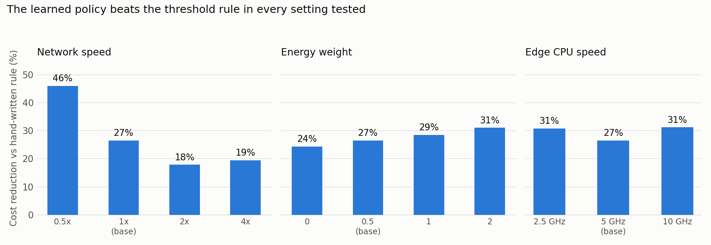

# Prediction-Aware Computation Offloading in Edge-Cloud Systems

A small simulation study of one question: **how much does a learned offloading policy improve on a simple hand-written rule, and when does predicting the network help?**

A phone running a heavy task can run it itself (device), send it to a nearby edge server, or send it to the cloud. The best choice depends on the task's size and deadline and on the network speed, which keeps changing. This project builds a simulator for that decision and compares policies on it.

## What's in the simulator

- Three tiers: device, edge, cloud, each with a CPU speed, a round-trip delay and a link speed.
- A mobile-like bandwidth trace that drifts and suffers sudden drops.
- Random tasks with a compute size, an upload size and a deadline.
- One cost number per task: `latency + 0.5 × energy + 5 if the deadline is missed` (lower is better).

Policies compared:

| Policy | What it does |
|---|---|
| always-local / always-edge / always-cloud | Fixed rules |
| threshold | A hand-written rule based on task size and the last seen bandwidth |
| model-based | Knows the exact cost formula and picks the cheapest tier using the last seen bandwidth |
| bandit | A contextual bandit that learns from experience which tier is cheapest, without being told the formula |
| oracle | Like model-based, but sees the true current bandwidth. Not achievable in practice; a lower bound |

## Results

Scored on the last 30% of 5,000 tasks. The bandit learns on the first 70% and is averaged over 5 seeds.

| Policy | Latency (s) | Energy (J) | Cost | Missed deadlines |
|---|---|---|---|---|
| always-local | 2.974 | 2.677 | 5.620 | 26.2% |
| always-edge | 3.185 | 3.535 | 6.143 | 23.8% |
| always-cloud | 4.237 | 5.141 | 8.412 | 32.1% |
| threshold | 2.454 | 2.579 | 4.578 | 16.7% |
| model-based | 1.709 | 1.549 | 3.037 | 11.1% |
| **bandit** | 1.870 | 1.723 | 3.363 | 12.6% |
| oracle | 1.665 | 1.487 | 2.932 | 10.5% |

**1. The learned policy beats the hand-written rule.** The bandit cuts cost by 26.5% against the threshold rule in the main run. Across 10 independent random draws of the bandwidth trace and tasks, the gain averages **23.3%** (range 20.0% to 27.9%). It stays about 11% above the model-based policy, which is given the cost formula for free.

**2. The gain holds when settings change.** Across 11 variations of network speed, energy weight and edge CPU speed, the bandit's gain over the threshold rule ranges from 18% to 46%. It is largest when the network is slow and smallest when it is fast.



**3. Prediction helps only a little, and only with a clean signal.** We simulated a signal-strength reading that leads the bandwidth by one step, and fed it to a linear-regression forecaster. With a clean signal, forecasting cuts the model-based policy's cost by 3.4% (3.037 to 2.934, against an oracle at 2.932). As the signal gets noisy, the gain falls to under 1%. On a purely random trace, the best forecast of the next speed is almost the last speed.

## Parameters and where they come from

| Parameter | Value | Source |
|---|---|---|
| Device CPU | 1.0 GHz | Chen et al. |
| Cloud CPU | 10 GHz | Chen et al. |
| Cloud round-trip time | 70 ms | Huang (median 69.5 ms) |
| Mean uplink speed | about 5.7 Mbps | Huang (median LTE uplink 5.64 Mbps) |
| Power: compute / idle / send | 0.9 / 0.3 / 1.3 W | Kumar and Lu (HP iPAQ example) |
| Edge CPU, edge round-trip time, edge link speed | 5 GHz, 10 ms, 1.5× | **Assumption** |
| Energy weight, deadline penalty | 0.5, 5 | **Assumption** |
| Deadlines | 1 to 8 s | **Assumption** |
| Task sizes | random, mean about 3 Gcycles and 2 MB | **Assumption**, same range as Chen et al.'s example (1 Gcycle, 5 MB) |

## Limitations

- This is a simulation. No real phone, network or server was measured.
- The literature values date from 2010 to 2015. Phones and networks are faster now, so absolute numbers are not meant to describe current hardware. The comparison between policies is the point.
- The edge-tier values and the deadline range are my own assumptions. The edge CPU speed was varied in the robustness check and did not change the conclusion; the other edge values were not.
- The signal-strength reading in the prediction experiment is simulated, based on the assumption that it leads throughput. It is not a measurement.
- The threshold rule is a simple rule written for this project. Its cutoffs were scaled with network speed but not tuned separately for each setting. A carefully tuned rule would likely narrow the gap.
- Bandit settings (bucket edges, exploration schedule) were chosen once and not tuned.

## How to run

```
pip install numpy matplotlib
```

Open `offloading_simulation.ipynb` and run all cells from the top. The full run takes about a minute. It writes `robustness.png`.

## References

- K. Kumar and Y.-H. Lu, "Cloud Computing for Mobile Users: Can Offloading Computation Save Energy?", *IEEE Computer*, April 2010. (Power values.)
- Chen et al., "Efficient Multi-User Computation Offloading for Mobile-Edge Cloud Computing", arXiv:1510.00888. (CPU speeds, task sizes.)
- Huang, PhD thesis, University of Michigan, 2013. (LTE throughput and round-trip time.)

## Author

* **Name:** Aabia Khan
* **Academic Track:** B.Sc. Mathematics Student
